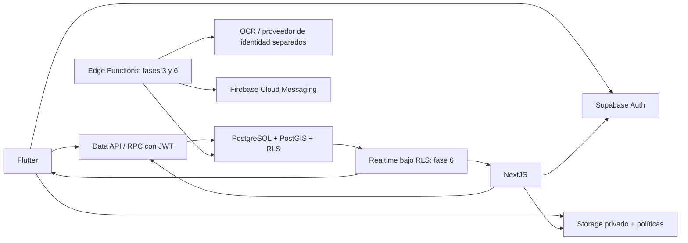

# Diseño y límites de la fase 1

## Comunicación

Flutter y Next.js utilizan Supabase Auth para obtener sesiones. Las consultas autorizadas pasan por la Data API con JWT del usuario y RLS. PostgreSQL es la autoridad de permisos, municipio, estados e integridad. PostGIS almacena puntos geográficos y zonas. Storage conserva objetos privados, separados de sus metadatos relacionales. Next.js nunca envía una clave service role al navegador.

Las futuras Edge Functions verificarán JWT, autorización municipal, tamaño y contenido de archivos, firma de webhooks e idempotencia. El cliente no decide que una identidad está verificada. El proveedor OCR solo extrae campos; `IdentityVerificationProvider` produce una decisión verificable o revisión manual autorizada. Realtime se habilitará explícitamente en fase 6 con suscripciones acotadas; no se publica ninguna tabla sensible ahora.

## Decisiones

- El perfil tiene un municipio. La pertenencia administrativa se expresa con `user_roles` y un municipio explícito. Un SUPER_ADMIN usa una asignación global reservada; se aprovisiona desde servidor/SQL administrativo.
- Las FK compuestas incluyen municipio para impedir referencias cruzadas aun desde procesos de servidor.
- Los operadores y supervisores tienen lectura por asignación; administradores municipales pueden leer el municipio completo. Los permisos de identidad se otorgan aparte.
- La fase 1 crea el modelo completo y lecturas seguras; las escrituras de negocio quedan cerradas a los clientes hasta que cada fase agregue RPC transaccionales validadas.
- No se habilita todavía creación de reportes: el futuro RPC validará identidad, consentimiento, formulario dinámico, evidencia, ubicación y límites. No se concede INSERT directo.
- `location geography(Point,4326)` es la única fuente de coordenadas; latitud/longitud se derivan para evitar inconsistencias. GiST permite consultas por distancia en metros.
- Las transiciones se auditarán transaccionalmente. Ya se registra historial al insertar/cambiar estado por un proceso autorizado; las reglas de transición del workflow se incorporan en fase 5.
- Folio generado por secuencia del servidor, único global, con año UTC. Se permiten huecos; no es una secuencia contable ni sustituye UUID. Idempotencia por ciudadano y clave de solicitud.
- No hay mapa público de reportes: el mapa ciudadano mostrará solo reportes propios. Una futura publicación requerirá una proyección anonimizada explícita.

## API por fase

Lecturas directas bajo RLS: catálogos del municipio activo, perfil propio, reportes propios/autorizados, historial y comentarios públicos del reporte. Identidad, auditoría y asignaciones requieren permisos específicos. No se concede acceso anónimo a tablas de aplicación.

Fase 2: Auth SDK para registro/login/recuperación; RPC limitada para completar perfil; administración de roles desde backend. Fase 3: consentimiento inmutable, tickets de upload, OCR/proveedor, revisión de identidad, URLs de corta duración y purga mediante Edge Functions. Fase 4: RPC `create_report` con idempotencia y validación de esquema dinámico; servicio de validación y promoción de fotografías. Fase 5: RPC de transición, prioridad y asignación con permisos e historial. Fase 6: outbox transaccional, consumidores con reintento para FCM y suscripciones filtradas. Fase 7: búsquedas PostGIS, agregados con permisos, SLA y sincronización offline.

No se crean endpoints vacíos ni funciones que simulen estas operaciones.

## Roadmap y criterios de salida

1. **Infraestructura:** migraciones reproducibles, PostGIS, RLS, Storage privado, seed local y pruebas de aislamiento. Es el alcance de esta entrega.
2. **Autenticación:** Flutter inicial, Auth, email confirmado, recuperación, perfiles y asignación administrativa segura. Probar escalación de privilegios y sesiones.
3. **Identidad:** consentimiento versionado, cámara, calidad, OCR separado, proveedor, revisión y retención operativa. Probar expiración y acceso restringido.
4. **Reportes:** wizard real, catálogos, GPS, evidencia, formularios validados, RPC e idempotencia. Probar reintentos y validaciones de servidor.
5. **Administración:** Next.js, tabla paginada, mapas, filtros, prioridad, estados y asignaciones. Probar roles y transiciones.
6. **Eventos:** Realtime, notificaciones FCM y alertas. Probar filtrado, entrega y deduplicación.
7. **Avanzadas:** SLA, analítica, duplicados sugeridos, mapas de calor, offline y exportación. Probar carga y recuperación.

Antes de producción se necesitan municipio real, aviso de privacidad aprobado, plazos de retención, proveedor de identidad, proveedor cartográfico y configuración FCM. No se bloquea la infraestructura local por estas decisiones.

## Actualización de fase 2

Flutter y las RPC de alta/edición de perfil ya están implementados. La asignación de CITIZEN ocurre en servidor después de confirmar correo. Los roles administrativos siguen reservados a operaciones autorizadas de servidor; no se confían metadatos editables del usuario. Consulta docs/fase-2-autenticacion.md para ejecución y pruebas pendientes.

