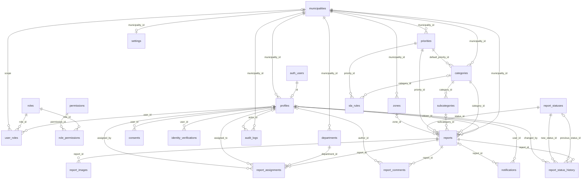

# Modelo de datos de fase 1

Definición ejecutable y tipos exactos: `supabase/migrations/20260919000826_phase1_schema.sql`. Las siguientes relaciones ya existen, aunque sus flujos de escritura se desarrollen después. Todos los identificadores de entidad son UUID; fechas usan timestamptz. Las tablas puente usan claves compuestas.

## Identidad y autorización

- `municipalities`: PK id; name, state, logo_url, is_active y timestamps. No se puede eliminar un municipio referenciado.
- `profiles`: PK y FK id → auth.users; FK municipality_id. Nombre/apellidos/teléfono son PII; identity_status, is_active y deleted_at son campos protegidos. Teléfono opcional E.164. UNIQUE(id, municipality_id) permite relaciones de pertenencia estrictas. Índice por municipio. No hay credenciales duplicadas.
- `roles`: PK id; code único entre los seis roles definidos; description. Catálogo global estructural.
- `permissions`: PK id; code único, description. Catálogo global granular.
- `role_permissions`: PK(role_id, permission_id); ambas columnas FK. No editable por clientes.
- `user_roles`: PK id; FK user_id, municipality_id y role_id; FK compuesta usuario/municipio. UNIQUE NULLS NOT DISTINCT(user_id, municipality_id, role_id). Municipio NULL únicamente para SUPER_ADMIN. Índice de búsqueda por usuario y municipio.
- `identity_verifications`: PK id; FK(user_id, municipality_id); proveedor/referencia opcionales con unicidad conjunta; document_type INE, status enum, verification_metadata JSON objeto, fechas de verificación/rechazo/expiración y purga. VERIFIED exige fechas de verificación y expiración; REJECTED exige fecha de rechazo. Todos sus datos son restringidos; nunca guardar la imagen en JSON. Índices por usuario, cola municipal y fecha de purga.
- `consents`: PK id; FK(user_id, municipality_id); tipo, versión de aviso y accepted_at. UNIQUE(user_id, consent_type, privacy_notice_version). Evidencia de consentimiento inmutable para clientes.

## Configuración municipal

- `priorities`: PK id; FK municipality_id; name y rank positivos únicos dentro del municipio, is_active. UNIQUE(id, municipality_id).
- `report_statuses`: PK id; code único limitado a nueve estados; name, is_terminal. Catálogo global del workflow inicial.
- `departments`: PK id; FK municipality_id; nombre único municipal, is_active y timestamps. UNIQUE(id, municipality_id).
- `zones`: PK id; FK municipality_id; nombre único municipal, boundary geometry(MultiPolygon,4326) válida/no vacía. UNIQUE(id, municipality_id), índice GiST de boundary.
- `categories`: PK id; FK municipality_id; FK(default_priority_id, municipality_id); nombre único municipal, descripción, icono, requisitos foto/GPS, visibilidad/actividad/orden, dynamic_form_schema JSON objeto y timestamps. UNIQUE(id, municipality_id). La validación semántica del esquema y respuestas se incorporará antes de habilitar escrituras en fase 4.
- `subcategories`: PK id; FK(category_id, municipality_id); nombre único por categoría, actividad/orden. UNIQUE(id, category_id, municipality_id) impide reportes con subcategoría de otra categoría.
- `settings`: PK/FK municipality_id; retención identidad/evidencia opcional de 1–3650 días, versión/URL del aviso, contacto de emergencia, máximo de imágenes 1–10 y updated_at. NULL en retención significa pendiente de configuración, nunca conservación indefinida por omisión. No contiene secretos.
- `sla_rules`: PK id; FK municipality_id, FK(priority_id, municipality_id), FK opcional(category_id, municipality_id). Tiempos positivos, resolución ≥ respuesta, actividad. UNIQUE NULLS NOT DISTINCT(municipality_id, category_id, priority_id) permite una regla general por prioridad.

## Operación

- `reports`: PK id; folio único generado por trigger; FK citizen/category/priority/zone con municipio; FK subcategory con categoría y municipio; FK status global. Descripción 10–5000 caracteres, location geography(Point,4326), dirección aproximada ≤500, precisión no negativa, captured_at; additional_data y snapshot de esquema como JSON objetos. UUID de idempotencia obligatorio y UNIQUE(citizen_id, idempotency_key); fechas creación/modificación/resolución/cierre. UNIQUE(id, municipality_id). Ubicación, texto y datos adicionales pueden contener PII: no son públicos.
- `report_images`: PK id; FK(report_id, municipality_id); storage_path único, MIME permitido, tamaño 1–10 MiB, created_at. Sin bytes ni URLs permanentes. Índice report_id. La ruta se crea desde servidor en fase 4.
- `report_status_history`: PK id; FK(report_id, municipality_id), estados previo/opcional y nuevo/obligatorio, changed_by opcional, comentario ≤2000 y created_at. Índice reporte/fecha. El trigger registra entrada inicial y cada cambio de estado; los comentarios deben ser aptos para el ciudadano, las notas internas van en report_comments.
- `report_assignments`: PK id; FK reporte/departamento/persona asignada con municipio, FK assigned_by; fechas. Un único destino activo por reporte mediante índice único parcial; una asignación puede ser departamental sin persona. Índice por persona y reporte activo. La pertenencia a rol operativo se validará en RPC de fase 5.
- `report_comments`: PK id; FK(report_id, municipality_id), FK autor opcional; body 1–4000, is_internal predeterminado true y fecha. Índice reporte/fecha. Contenido potencialmente sensible; visibilidad independiente de la del reporte.
- `notifications`: PK id; FK usuario/municipio y reporte/municipio opcional; title ≤200, body ≤1000, read_at y fecha. Índice usuario/fecha. Solo destinatario. El dispositivo/token FCM y outbox se diseñarán en fase 6.
- `audit_logs`: PK id; FK municipality_id y actor opcional; acción, tipo de entidad e ID polimórfico, old_values/new_values/metadata JSON y fecha. entity_id no tiene FK porque identifica distintas tablas. Índice municipio/fecha; no guardar secretos, tokens, INE ni PII innecesaria.

## Índices y consultas

Reportes: municipio/fecha/UUID para paginación; ciudadano/fecha/UUID; municipio/estado/prioridad/fecha; municipio/categoría/fecha; GiST location. En fase 4 usar proyecciones selectivas y en fase 5 paginación de servidor. No hay endpoints de listado que descarguen todo. Las consultas de cercanía usarán ST_DWithin con geography y distancia en metros, siempre bajo autorización. No se marcarán duplicados automáticamente.

La integridad estructural ya está en base de datos. Requisitos de foto/GPS por categoría, validación JSON Schema, verificación vigente, autorización de asignados y transiciones de negocio permanecen pendientes; ninguna escritura de cliente puede saltarlos porque aún no está habilitada.
